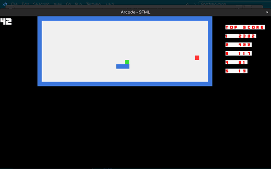
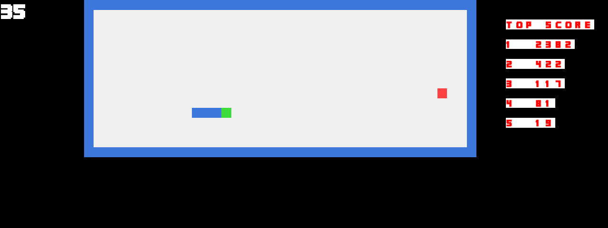
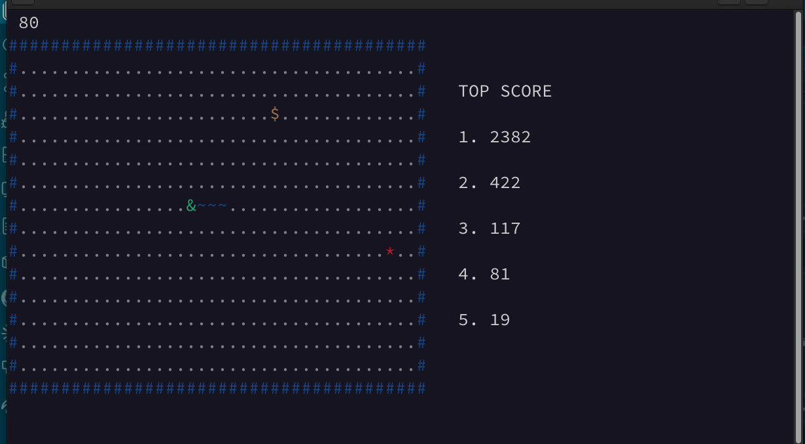
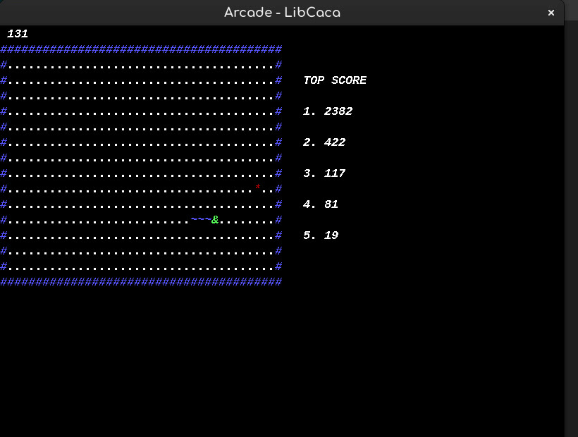
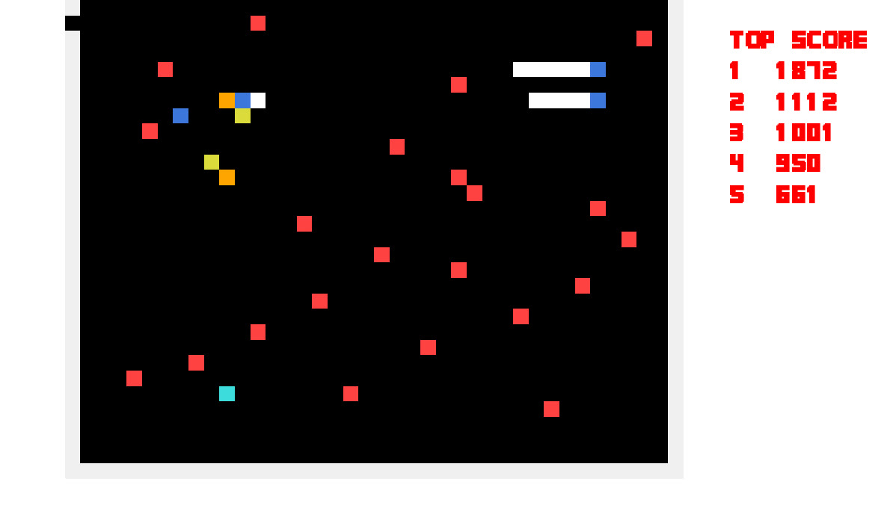

# Arcade — borne d'arcade à plugins en C++ (Epitech, 2e année)

> **EN** — A retro arcade platform in C++ (Epitech, Mar.–Apr. 2025, team of 3, I was the team lead). The core
> loads games and graphics libraries as shared objects (`.so`) at runtime: Snake and Centipede, rendered with SFML,
> SDL2, ncurses or libcaca, and you can **switch the graphics library in the middle of a game** without losing it.

**Arcade** est une borne d'arcade logicielle. Le cœur du programme ne connaît ni les jeux ni l'affichage : il charge
au démarrage des bibliothèques dynamiques (`.so`) avec `dlopen`, les unes pour les jeux, les autres pour le rendu.
On choisit un jeu et une bibliothèque graphique dans le menu, puis `F2` change l'affichage **en pleine partie** :
la partie continue, seule la fenêtre change (SFML, SDL2, une fenêtre libcaca ou directement le terminal avec ncurses).

🎬 Vidéo (40 s) : Snake qui passe de SFML à ncurses puis à libcaca, puis Centipede en SDL2 : [media/gameplay.mp4](media/gameplay.mp4)

| Snake · SFML | Snake · ncurses (terminal) |
| --- | --- |
|  |  |
| **Snake · libcaca** | **Centipede · SDL2** |
|  |  |

## Le principe

- **Un cœur, des plugins** : `./arcade lib/arcade_sfml.so` démarre avec la bibliothèque donnée. Le cœur cherche
  ensuite dans `lib/` les jeux et les bibliothèques graphiques disponibles et les propose dans le menu.
- **Deux interfaces** : un jeu implémente `IGames` (`init`, `update`, `getPixelMap`, `getScore`, `isGameOver`,
  `reset`), un affichage implémente `IGraphics` (`createWindow`, `draw`, `drawText`, `display`, `getEvent`).
  Chaque `.so` exporte une fonction `extern "C"` (`createGame` ou `createGraphic`) que le cœur appelle via `dlsym`.
- **Un format neutre entre les deux** : le jeu produit une liste de « pixels » (position, symbole, couleur) et
  l'affichage la dessine à sa manière, rectangles colorés en SFML / SDL2, caractères en ncurses / libcaca.
  Les touches sont traduites en événements communs (`UP`, `ACTION1`, `NEXT_GRAPHIC`…).
- **Interfaces partagées** : le sujet impose que les interfaces soient communes avec un autre groupe, pour que
  les bibliothèques de l'un fonctionnent avec le cœur de l'autre.

## Les jeux

- **Snake** : pommes placées au hasard, pomme bonus, vitesse qui augmente au fil de la partie, meilleurs scores.
- **Centipede** : le joueur se déplace dans le bas de l'écran et tire sur des mille-pattes qui descendent en
  zigzag entre les champignons ; tableau des meilleurs scores.

Commandes : flèches, `Entrée` pour lancer, `Espace` pour tirer, `F1` jeu suivant, `F2` bibliothèque graphique
suivante, `R` recommencer, `Échap` retour au menu, `Retour arrière` quitter.

## Technique

- C++17, environ 2 900 lignes, `std::unique_ptr` et `dlopen` / `dlsym` / `dlclose` encapsulés dans un
  `DLLoader<T>` générique.
- Quatre bibliothèques graphiques : SFML, SDL2 (+ SDL2_ttf), ncurses, libcaca. Un Makefile par partie
  (cœur, jeux, affichages) ; chaque module produit son `.so` dans `lib/`.
- Le menu est lui-même un « jeu » chargé en `.so`, ce qui permet de l'afficher dans chaque bibliothèque.
- Documentation Doxygen et un guide pour ajouter un jeu ou une bibliothèque graphique.

Architecture : [docs/ARCHITECTURE.md](docs/ARCHITECTURE.md) · Installation : [docs/INSTALL-fedora.md](docs/INSTALL-fedora.md)

## Mon rôle

Chef d'équipe d'un groupe de **trois** (mars–avril 2025) avec Thomas Camuset et Thibaut Louis ; j'ai fait
68 des 112 commits :

- l'architecture : le chargeur `DLLoader`, les interfaces `IGraphics` / `IGames` et leur classe de base `AGame` ;
- le menu, chargé lui aussi comme un `.so`, et son affichage dans toutes les bibliothèques ;
- Centipede : déplacement du joueur, mouvement des mille-pattes, couleurs, meilleurs scores ;
- Snake : intégration, directions, redémarrage, carte agrandie, vitesse progressive, meilleurs scores ;
- couleurs communes et affichage adaptatif en SFML et SDL2, découpage en Makefiles, relecture et nettoyage final.

Thomas a écrit les affichages ncurses et libcaca et le changement de bibliothèque et de jeu en cours de partie ;
Thibaut a stabilisé l'affichage SDL2, enrichi Snake (pommes bonus, accélération), géré les meilleurs scores et la
documentation.

## Code source

Le code source et son historique complet sont dans un dépôt privé :
[FuniclemDev/arcade-source](https://github.com/FuniclemDev/arcade-source) (accès sur demande).
Ce dépôt public ne contient que la présentation, la documentation et les médias : le code des projets Epitech
n'est pas publié en accès libre.

---
Clément Dorge · [clementdorge.com](https://clementdorge.com/fr/projets/arcade/) · Epitech Strasbourg
